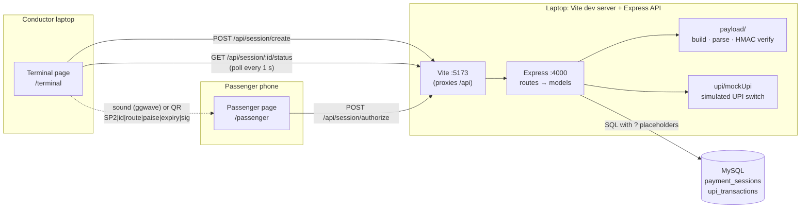
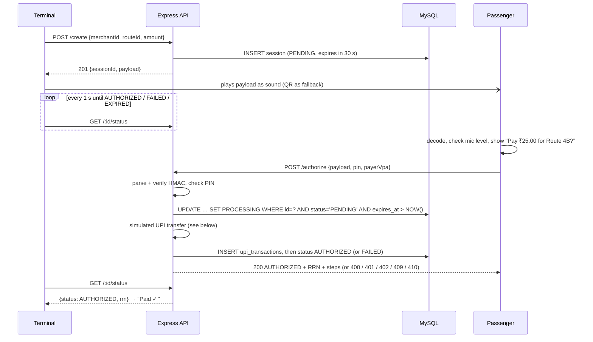
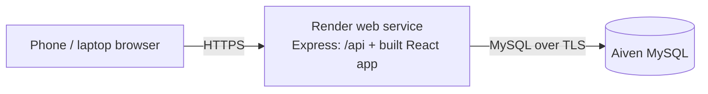
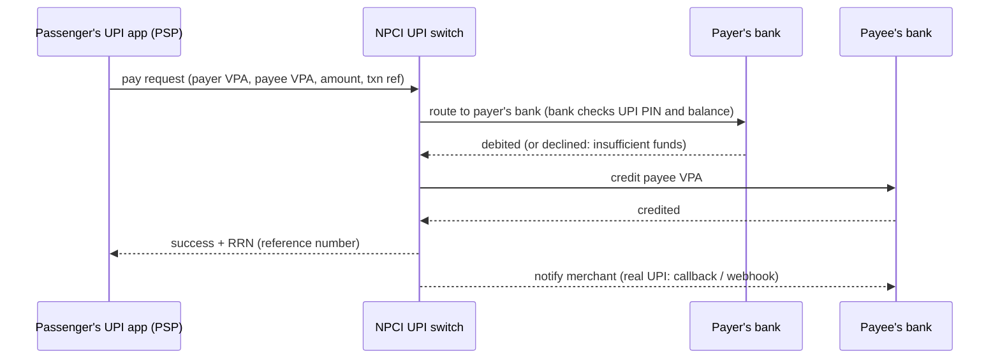

# SoundPay – sound-based bus ticket payment (prototype)

A learning prototype built for an interview demo. **Payments are simulated: no real
money moves, there is no payment gateway, and the PIN is a mock.**

A conductor's **terminal** page encodes a payment request into a short burst of
audible sound. A **passenger** page on a different device listens through the
microphone, decodes it, and asks "Pay ₹25.00 for Route 4B?". The passenger picks a
demo UPI account and approves with a mock PIN; the server runs a **simulated UPI
transfer** (payer's app → NPCI → payer's bank → payee's bank → RRN) and both screens
show **Paid ✓** with the reference number. If sound doesn't work, both pages fall back
to a QR code carrying the same payload.

## Tech stack

| Part | Tools |
|---|---|
| Frontend | React 19 + Vite, React Router (`/terminal`, `/passenger`) |
| Sound | [`ggwave`](https://github.com/ggerganov/ggwave) (WebAssembly), protocol `GGWAVE_PROTOCOL_AUDIBLE_FAST` |
| QR | `qrcode` (show), `html5-qrcode` (scan) |
| Backend | Node.js + Express 5 |
| Database | MySQL 8 with `mysql2` (plain SQL, parameterised queries, no ORM) |
| Tests | Jest + Supertest, DB layer mocked (no MySQL needed) |

## Architecture





## Folder structure

```
soundpay/
├── server/
│   ├── server.js                 starts the app (checks required .env values)
│   ├── schema.sql                payment_sessions + upi_transactions (safe to re-run)
│   ├── scripts/initDb.js         npm run db:init
│   ├── src/
│   │   ├── app.js                Express app (no listen, so tests can import it)
│   │   ├── db.js                 mysql2 connection pool
│   │   ├── dbConfig.js           connection settings (+ optional SSL for cloud MySQL)
│   │   ├── ids.js                12-char session ids, 12-digit RRNs
│   │   ├── validation.js         request checks + rupees → paise
│   │   ├── httpError.js          Error with an HTTP status
│   │   ├── errorHandler.js       404 + central JSON error handler
│   │   ├── models/               sessionModel.js, upiModel.js (all SQL)
│   │   ├── routes/               sessionRoutes.js, upiRoutes.js
│   │   ├── upi/mockUpi.js        SIMULATED UPI switch (PSP → NPCI → banks)
│   │   └── payload/payload.js    buildPayload / parsePayload / verifySignature
│   └── tests/                    payload, session, mockUpi, dbConfig
├── client/
│   ├── vite.config.js            /api proxy, optional HTTPS mode
│   └── src/
│       ├── sound/ggwave.js       ALL ggwave code: encodeToAudio, playAudio, startListening, stopListening
│       ├── pages/TerminalPage.jsx
│       ├── pages/PassengerPage.jsx
│       ├── components/QrCode.jsx, QrScanner.jsx, UpiTimeline.jsx
│       ├── api.js, payload.js, money.js
│       └── styles.css
├── render.yaml                   Render deployment (Blueprint)
├── README.md
└── INTERVIEW_NOTES.md
```

## Setup

> Use a folder path **without special characters** if you can. Characters such as `&`
> break npm's `.cmd` shims on Windows. This project lives under `H&R BLOCK\…`, so its npm
> scripts call `node node_modules/<tool>/…` directly to work around that.

Requirements: Node.js 20+ (built with 22), MySQL 8.

**1. Install**

```bash
cd server
npm install
cd ../client
npm install
```

**2. Configure** – copy `server/.env.example` to `server/.env` and fill it in:

| Variable | Meaning |
|---|---|
| `PORT` | API port (default 4000; the Vite proxy expects 4000) |
| `DB_HOST`, `DB_PORT`, `DB_USER`, `DB_PASSWORD`, `DB_NAME` | MySQL connection |
| `PAYLOAD_SECRET` | HMAC key. Generate one: `node -e "console.log(require('crypto').randomBytes(32).toString('hex'))"` |
| `MOCK_PIN` | The simulated PIN the passenger types (e.g. `1234`) |

**3. Create a MySQL account** (as root, e.g. in MySQL Workbench) – an account that can
only use the `soundpay` database:

```sql
CREATE USER 'soundpay_app'@'localhost' IDENTIFIED BY 'same-as-DB_PASSWORD';
GRANT ALL PRIVILEGES ON soundpay.* TO 'soundpay_app'@'localhost';
```

**4. Create the tables**

```bash
cd server
npm run db:init
```

## Run

Two terminals:

```bash
cd server
npm run dev          # API on http://localhost:4000
```

```bash
cd client
npm run dev          # http://localhost:5173
```

Open http://localhost:5173/terminal and http://localhost:5173/passenger. On one laptop,
the laptop's own mic can hear its speaker; turn the volume up and use "Replay sound".

## Tests

```bash
cd server
npm test
```

78 tests, no MySQL needed (the model modules are replaced with `jest.fn()` mocks; the
simulated UPI switch runs for real with no delays):

- **payload** – build → parse round trip; tampered amount / route / wrong secret fail
  verification; 17 kinds of malformed strings (incl. old SP1 / UUID formats) are
  rejected; the largest payload stays at most 64 bytes.
- **create** – valid request 201 (short id, SP2 payload that verifies); rupees → paise;
  bad amount / route 400; invalid JSON 400; DB failure 500 without leaking details.
- **authorize** – success 200 with RRN + steps; amount taken from the DB; insufficient
  funds / unknown VPA 402 (session FAILED); crash mid-transfer → 500 and session not
  left PROCESSING; tampered 400; bad VPA 400; wrong PIN 401 (DB never touched); second
  use 409; while processing 409; after failure 409; expired 410; unknown session 404.
- **mockUpi** – success hops + 12-digit RRN; insufficient funds; unknown VPA.
- **status** – PENDING / PROCESSING / AUTHORIZED (+RRN) / FAILED / EXPIRED, 404, bad id 400.
- **dbConfig** – no SSL locally; SSL with certificate checking when `DB_SSL=true`.

Limit of mocked tests: they check the route logic, not the SQL itself. For example,
deleting `AND status = 'PENDING'` from the claim UPDATE would not fail any test. Integration
tests against a real test database would close that gap.

## Two-device demo (laptop = terminal, phone = passenger)

Browsers only allow the **microphone and camera on HTTPS or `localhost`**. On the
phone, the laptop is not `localhost`, so the phone needs HTTPS. Two ways:

### Option A – self-signed HTTPS on your Wi-Fi (no account needed)

1. Laptop and phone on the **same Wi-Fi** (not a guest network that isolates devices).
2. Start the API as usual (`cd server`, `npm run dev`).
3. Start the client in HTTPS mode:
   ```bash
   cd client
   npm run dev:https
   ```
   Vite prints a `Network:` address, e.g. `https://192.168.1.9:5173/`
   (`ipconfig` → "IPv4 Address" shows the same IP).
4. Windows may ask whether Node.js can use the network – allow it on **Private** networks.
5. Laptop: open `https://localhost:5173/terminal` (accept the certificate warning).
6. Phone: open `https://<laptop-ip>:5173/passenger`. You will see a certificate warning
   because the certificate is self-signed – that is expected for a local prototype:
   - Android Chrome: **Advanced → Proceed to … (unsafe)**
   - iPhone Safari: **Show Details → visit this website**
7. Generate a ticket on the laptop, tap **Tap to listen** on the phone and allow the mic.

Only the Vite server is exposed; it forwards `/api` to Express on the laptop, so the
phone never needs port 4000.

### Option B – a tunnel (real HTTPS certificate)

```bash
cd client
npm run dev
```

In another terminal (after installing [cloudflared](https://developers.cloudflare.com/cloudflare-one/connections/connect-networks/downloads/)):

```bash
cloudflared tunnel --url http://localhost:5173
```

It prints a `https://….trycloudflare.com` address – open `/terminal` and `/passenger` on
it. (`ngrok http 5173` works the same way.) `vite.config.js` already allows these
hostnames. Note this makes your dev server reachable from the internet while the tunnel
runs – stop it after the demo.

### Demo tips

- Sound takes about **3.9 s** to play (52 bytes; was 5.4 s with the old 76-byte SP1
  format), well inside the 30 s window.
- Start listening on the phone **before** the sound plays, or press **Replay sound**.
- Hold the phone 10–50 cm from the laptop speaker. In a noisy room, raise the volume.
- If the level meter stays low, lower the proximity threshold under **Demo settings**
  (0 turns it off). Laptop and phone mics differ a lot.
- If sound fails completely, use **Scan QR instead**.

## Deploy for free (Render + Aiven MySQL)

Render hosts the app for free but has no free MySQL, so the database lives on Aiven's
free MySQL plan. When deployed, **Express also serves the built React app**, so
everything is one HTTPS URL (same origin, no CORS) – and HTTPS means the mic and camera
work on any phone.



### 1. Create the database (Aiven)

1. Sign up at [aiven.io](https://aiven.io) → **Create service** → **MySQL** → **Free plan**.
2. When it's running, open the service's **Overview** and note **Host**, **Port**,
   **User** (`avnadmin`) and **Password**, and download the **CA certificate** (`ca.pem`).
   Keep these private – don't commit them.

### 2. Put the code on GitHub

Create an **empty** repository on GitHub (no README), then from the `soundpay` folder:

```bash
git add -A
```
```bash
git commit -m "SoundPay prototype"
```
```bash
git remote add origin https://github.com/<you>/soundpay.git
```
```bash
git push -u origin main
```

`.gitignore` keeps `.env`, `*.local.sql` and certificates out of the repository.

### 3. Deploy on Render

1. Sign up at [render.com](https://render.com) with GitHub → **New** → **Blueprint** →
   pick the repository. Render reads [`render.yaml`](render.yaml).
2. It asks for the values marked secret – paste them from Aiven:
   `DB_HOST`, `DB_PORT`, `DB_USER`, `DB_PASSWORD`, and `DB_SSL_CA` (open `ca.pem` in a
   text editor and paste the whole thing, including the BEGIN/END lines).
   `PAYLOAD_SECRET` is generated by Render; `MOCK_PIN` is `1234`; `DB_SSL` is `true`.
3. **Apply**. The build installs everything, builds the client, and runs
   `npm run db:init`, which creates the `soundpay` database and table on Aiven
   (safe to repeat – it uses `IF NOT EXISTS`).
4. Open `https://<your-service>.onrender.com/terminal` on the laptop and
   `https://<your-service>.onrender.com/passenger` on the phone.

**No Blueprint option?** Create the service by hand instead: **New → Web Service** →
pick the repository, and fill in:

| Field | Value |
|---|---|
| Language | Node |
| Branch | `main` |
| Root Directory | *(leave empty)* |
| Build Command | `cd client && npm ci --include=dev && npm run build && cd ../server && npm ci && npm run db:init` |
| Start Command | `cd server && node server.js` |
| Instance Type | Free |
| Health Check Path (Advanced) | `/api/health` |

Environment variables: `NODE_VERSION`=`22`, `MOCK_PIN`=`1234`, `DB_NAME`=`soundpay`,
`DB_SSL`=`true`, `PAYLOAD_SECRET`=a long random string, plus `DB_HOST`, `DB_PORT`,
`DB_USER`, `DB_PASSWORD`, `DB_SSL_CA` from Aiven.

Every `git push` to `main` redeploys automatically.

### Free-tier behaviour to expect

- **Cold start:** the free Render service sleeps after ~15 minutes without traffic; the
  next request takes roughly 30–60 s. **Open the site a few minutes before a demo.**
- **Idle database:** free Aiven services can be powered off after a long idle period;
  turn it back on in the Aiven console if the app reports "Something went wrong".
- **Public URL:** anyone with the link can create (simulated) sessions; there is no
  rate limiting.
- Limits change – check Render's and Aiven's current free-plan pages.

## API

All responses are JSON. Errors always look like `{ "error": "message" }` (402 adds `code` and `steps`).

| Method & path | Body | Success | Errors |
|---|---|---|---|
| `POST /api/session/create` | `{ merchantId, routeId, amount }` – amount in rupees, > 0, ≤ 1000, max 2 decimals; routeId 1–10 of `A-Z a-z 0-9 -` | **201** `{ sessionId, payload, routeId, amountPaise, expiresInSeconds }` | 400 invalid input |
| `POST /api/session/authorize` | `{ payload, pin, payerVpa }` – payerVpa like `kesav@mockbank` | **200** `{ status: "AUTHORIZED", sessionId, routeId, amountPaise, payerVpa, payeeVpa, rrn, steps }` (takes ~1.5 s: simulated UPI hops) | 400 missing/invalid fields or `Invalid payload` (tampered or malformed), 401 `Wrong PIN`, **402** `Insufficient funds` / `Payment failed` with `{ code, steps }`, 404 session not found, 409 `Already paid` / `Payment already in progress` / failed earlier, 410 `Expired` |
| `GET /api/session/:id/status` | – | **200** `{ status, routeId, amountPaise, rrn }` – status is `PENDING`, `PROCESSING`, `AUTHORIZED`, `FAILED` or `EXPIRED` | 400 invalid session id, 404 not found |
| `GET /api/upi/demo-accounts` | – | **200** `{ accounts: [{ vpa, name, balancePaise }] }` (simulated) | – |
| `GET /api/health` | – | 200 `{ ok: true }` | – |

Any other path → 404 `{ "error": "Not found" }`. Unexpected errors → 500
`{ "error": "Something went wrong" }` (details only in the server log).

## Payload format

```
SP2|<sessionId>|<routeId>|<amountPaise>|<expiryUnix>|<sig>
SP2|k7qm2xpa9r4t|4B|2500|1761040000|9f86d081884c7d65
```

- `SP2` – format version. SP1 used 36-character UUIDs; SP2 uses 12-character ids
  (lowercase letters + digits, because MySQL compares text case-insensitively), which
  shortened the sound from 5.4 s to 3.9 s. Old SP1 tickets are rejected cleanly.
- `sig` – first 16 hex characters of HMAC-SHA256 over everything before it, keyed with
  `PAYLOAD_SECRET`. Compared with `crypto.timingSafeEqual`.
- About 52 bytes (at most 62); ggwave messages are limited to 140 bytes.

## Simulated UPI transfer

After the signature and PIN checks, the server runs a **simulated** UPI "pay" request
in [`server/src/upi/mockUpi.js`](server/src/upi/mockUpi.js). It follows the same hops
as a real one, records each with a timestamp, and the passenger's screen shows them as a
timeline. No bank or NPCI system is contacted and no money moves.



| Demo payer VPA | Balance | Result for a ₹25 fare |
|---|---|---|
| `kesav@mockbank` | ₹500 | Success, 12-digit RRN |
| `lowbalance@mockbank` | ₹10 | Declined – insufficient funds (402) |

The payee VPA comes from the merchant id (`BUS-DEPOT-1` → `bus-depot-1@mockbank`).
Session status flow: `PENDING → PROCESSING → AUTHORIZED | FAILED` (or `PENDING →
EXPIRED`). Every attempt, success or failure, is stored in `upi_transactions` with its
step log; `UNIQUE(session_id)` means a session can have at most one transfer.

**How the simulation differs from real UPI:** the real UPI PIN is encrypted on the phone
and checked only by the payer's bank (our mock PIN goes to our server); real failures use
NPCI's short response codes (ours use readable codes like `INSUFFICIENT_FUNDS`); demo
balances never go down; and a real transfer can end up *pending* (e.g. a bank timeout)
and be settled later by a status check or reconciliation – the simulation is always an
instant success or failure.

## Security – what this prototype does

- **HMAC signature stops changing the amount.** The signature is computed from the
  session id, route, amount and expiry using a secret only the server has. Change
  `2500` to `100` and the signature no longer matches; making a new valid one needs the
  secret. (Anyone can *read* the payload – HMAC protects integrity, not secrecy.)
- **One atomic UPDATE prevents replay and double payment.**
  `UPDATE … SET status='PROCESSING' WHERE id=? AND status='PENDING' AND expires_at > NOW()`
  checks and changes the row in one step, so only one request can ever claim it
  (`affectedRows = 1`) and reach the (simulated) bank. A separate SELECT-then-UPDATE
  would let two requests both see PENDING. A replay or a simultaneous double tap gets
  409. `UNIQUE(session_id)` on `upi_transactions` is a second, database-level guard.
- **The amount charged comes from the database**, not from the request.
- **30-second expiry limits relay and replay.** A recorded or forwarded payload is
  useless after 30 s, and the expiry is part of the signed data so it can't be extended.
- **The server decides.** The passenger page only *displays* the payload; the terminal
  only shows "Paid ✓" when the database says AUTHORIZED. A modified client can't fake
  that row.
- Parameterised SQL everywhere, a small JSON body limit, input validation, and generic
  500 messages.

## Limitations – what this prototype does NOT solve

- **Anyone nearby can hear the sound.** A nearby passenger could decode the same
  ticket. The **explicit confirmation + PIN** is what prevents accidental charges; the
  proximity (mic level) check is only a UX nudge – a louder speaker or a recording
  beats it.
- **A real-time relay within 30 s is still possible.** Expiry only shortens the window;
  real systems use distance bounding or device-bound cryptography (as NFC payments do).
- **No real payment gateway.** The UPI transfer is simulated (see above); nothing is
  charged, and the "pending" / reconciliation cases of real UPI are not modelled. If the
  server crashed after the simulated debit but before saving, the session would be
  marked FAILED – a real system would reconcile with the bank instead.
- **The mock PIN is not authentication.** One shared PIN from `.env`, no user accounts,
  no rate limiting or lockout after wrong attempts.
- **The signature is truncated to 64 bits** to keep the sound short. That's acceptable
  here because each payload is single-use and expires in 30 s, but it is a trade-off.
- **No user or merchant authentication on the API** – anyone who can reach it can
  create sessions.
- **Self-signed HTTPS** is for local testing only.
- Expired sessions are marked lazily (when someone asks); there is no cleanup job.
- Uses `ScriptProcessorNode` (deprecated but widely supported) instead of `AudioWorklet`.
- The ggwave decoder in this build only works at 48 kHz, so mic audio from devices running
  at other rates (often 44.1 kHz) is resampled to 48 kHz in the browser first.
